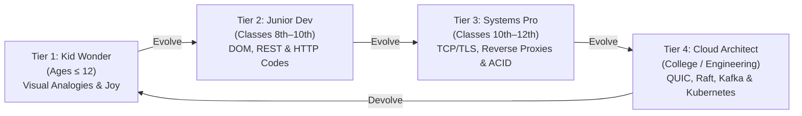

# 🚀 ATW WEB FLOW: 4D Web Flow Evolution Engine & Architecture Explorer

> **Repository**: [https://github.com/ATWISHERE/Webflow](https://github.com/ATWISHERE/Webflow)  
> **Target Audience**: From Curious Kids (Ages ≤12) to High Schoolers (8th–12th) & College Computer Science Engineers  
> **Tech Stack**: HTML5, Vanilla CSS3, JavaScript (ES6+), Three.js (WebGL), Web Audio API, Web Speech API

---

## 🌟 What is ATW WEB FLOW?
Traditional diagrams depict the internet as flat, lifeless 2D arrows. **ATW WEB FLOW adds Space (3D) AND Time (The 4th Dimension)** to reveal the secret life of the web!

Rather than dumbing down concepts or separating them across disconnected pages, **ATW WEB FLOW features an in-page 3D Evolution & Devolution Engine**. The entire world, character, and curriculum morph dynamically without a page reload:
- **Byte-Bot evolves from a tiny kid-friendly courier into a Titanium-armored Mk-II courier with ion jet thrusters and datalink visors**.
- The environment spawns **holographic circuit grids**, transforms day into cyber twilight, and unlocks **real-world production architectures, HTTP/3, TLS 1.3, Kafka event streams, and raw runnable code snippets**.
- **Devolve anytime**: Return instantly to Kid Wonder mode without breaking or refreshing the experience.

---

## 🧬 The 4 Evolution Tiers



### 1. 🎈 Tier 1: Kid Wonder (Under Age 12)
- **Metaphors**: Master Chef kitchen, Postal Courier, Recipe books, Library card catalog.
- **Focus**: Building excitement, visual cause-and-effect, HTML skeleton vs CSS clothes vs JS brain.
- **Bot Model**: Cute red cylinder body, cyan visor eyes, bouncy walk, golden gift box.

### 2. ⚡ Tier 2: Junior Dev (Classes 8th to 10th | Ages 13–15)
- **Topics**: DOM tree parsing, CSSOM, Event Loop & Call Stack, HTTP Methods (`GET`, `POST`, `PUT`, `DELETE`), HTTP status codes (`200 OK`, `301`, `400`, `404`, `500`), DNS record types (`A`, `AAAA`, `CNAME`, `MX`), and Browser storage (`localStorage` vs `sessionStorage` vs `Cookies`).
- **Bot Evolution**: Scales by 1.25×, equips Titanium Pauldrons, glowing Cyan Arc Reactor, Twin Rocket Jet Skates, and green "200 OK" status visor. Ground deploys glowing neon circuit grid.

### 3. 🛡️ Tier 3: Systems Pro (Classes 10th to 12th | Ages 16–18)
- **Topics**: TCP 3-Way Handshake (`SYN` -> `SYN-ACK` -> `ACK`), TLS 1.3 ECDH ephemeral key exchange, 5-Tier Caching Hierarchy (Browser -> Edge -> CDN -> Redis -> DB), Nginx reverse proxy configuration, SQL ACID transactions (`BEGIN`, `COMMIT`, `ROLLBACK`) vs NoSQL document collections.
- **Bot Evolution**: Holographic Cryptographic Shield Ring, dual-thruster particle trails, Mecha-Titan scale.

### 4. 🌌 Tier 4: Cloud Architect (College / University & Production Engineers)
- **Topics**: Distributed systems, HTTP/3 QUIC over UDP, CAP Theorem trade-offs, Raft consensus algorithm, Apache Kafka partition logs, Kubernetes deployment manifests & Envoy service mesh, BGP Anycast routing, Cloudflare V8 Edge worker isolates.
- **Bot Evolution**: Cosmic Sovereign Overclock mode with full telemetry HUD.

---

## 📂 Modular Stage Architecture

For 100% accuracy, clean isolation, and safety against regression errors, the repository is split into modular stage folders:

```
web flow/
├── stages/
│   ├── stage1/                       # 🛡️ 100% ISOLATED STAGE 1 BACKUP
│   │   ├── index.html                # Standalone Stage 1 Kid Wonder runner
│   │   ├── world.js                  # Pure Stage 1 3D scene
│   │   ├── app.js                    # Pure Stage 1 interaction logic
│   │   ├── style.css                 # Stage 1 stylesheet
│   │   ├── audio.js                  # Stage 1 audio synthesizer
│   │   ├── start.bat                 # Isolated launch script
│   │   ├── ATW_Web_Flow_Guide.docx   # Stage 1 guide document
│   │   └── generate_word_doc.py      # Docx generator
│   ├── stage2/
│   │   └── stage2_curriculum.js      # Junior Dev technical curriculum & code snippets
│   ├── stage3/
│   │   └── stage3_curriculum.js      # Systems Pro protocols & architecture models
│   └── stage4/
│       └── stage4_curriculum.js      # Cloud Architect distributed systems curriculum
│
├── RESEARCH_WEB_FLOW_LEVELS.md       # 📚 Comprehensive technical curriculum research
├── ATW_Web_Flow_Research_Curriculum.docx # 📄 Formal research paper & reference doc
├── index.html                        # Main multi-tier evolutionary web app
├── world.js                          # Multi-tier 3D Three.js engine with real-time morphing
├── app.js                            # Evolution controller & dynamic modal renderer
├── audio.js                          # Procedural synthesizer with evolution chimes
├── style.css                         # Tier navigation bar & syntax-highlighted modals
└── start.bat                         # Dual-device LAN server launcher (0.0.0.0:5173)
```

---

## 🕹️ Interactive Features

- **🧬 In-Page Evolution Engine**: Switch instantly between Tiers 1 through 4 via the top navigation bar. Elements emerge, robot equips armor, and lighting morphs seamlessly.
- **🎥 Free-Will Zoom Follow Camera**: Lock onto the robot while retaining total free-will to zoom in (6 units) or zoom out (180 units) to observe the API Drone and entire world.
- **⏱️ 4D Temporal Time Scrubber**: Scrub backwards and forwards in milliseconds to observe packet flight at your own pace, or press Spacebar to play/pause.
- **⚡ Speed Selector**: Choose between 🐢 **Slow** (0.25x), 🚶 **Normal** (0.6x), or 🏃 **Fast** (1.2x) playback.
- **💻 Live Dynamic Code Snippet Box**: In Tiers 2–4, clicking any station reveals syntax-highlighted production code (Node.js, Nginx, SQL, Go) with 1-click clipboard copy.
- **🔊 100% Procedural Web Audio Synth**: Synthesized robot pops, cat meows, drone hums, fanfare chords, and ascending/descending evolution chimes with zero external audio assets.
- **📱 Multi-Device Wi-Fi Sharing**: Connect mobile phones and tablets on the same Wi-Fi using the built-in `📱 Mobile Link` feature.

---

## 🏃 How to Run

### Method 1: Double-Click `start.bat` (Recommended!)
Just double-click **`start.bat`** in the project folder!
- Automatically frees port `5173` if occupied.
- Detects your computer's local Wi-Fi IP address.
- Binds to `0.0.0.0` so you can open it on your PC AND mobile phone simultaneously.
- Opens your default browser automatically to `http://localhost:5173/`.

### Method 2: Manual Terminal Command
```bash
# Using Python
python -m http.server 5173 --bind 0.0.0.0

# Or using Node.js
npx -y serve -p 5173 -l 0.0.0.0 .
```

- **PC Browser**: [http://localhost:5173/](http://localhost:5173/)
- **Mobile Browser**: `http://<your-lan-ip>:5173/` *(e.g. `http://192.168.1.2:5173/`)*

---

## ⌨️ Keyboard Controls
- `Spacebar`: Play / Pause 4D Time flow
- `Left / Right Arrows`: Scrub time backwards and forwards
- `Escape`: Close all open dialogs and modals
- `Mouse Wheel`: Zoom in / out freely in Follow Mode
- `Mouse Left-Click Drag`: Orbit and inspect the 3D scene from any angle
